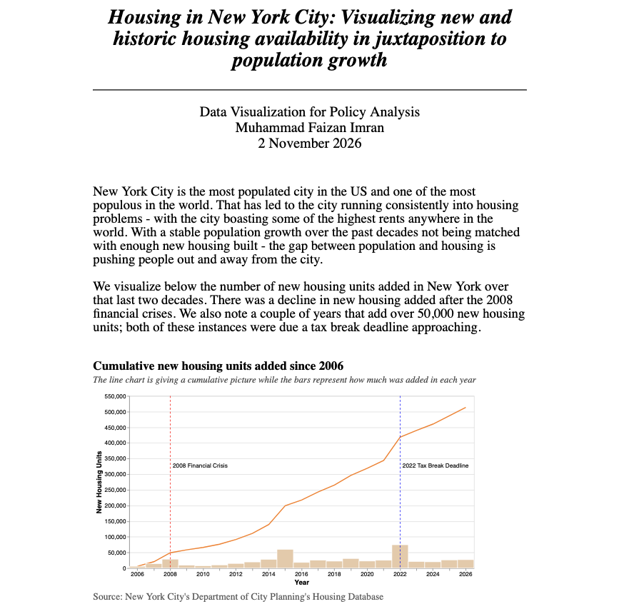

# Housing in New York City

Muhammad Faizan Imran

##Description

New York City is the most populated city in the US and one of the most populous in the world. That has led to the city running consistently into housing problems - with the city boasting some of the highest rents anywhere in the world. In this project I work with Department of City Planning's Housing Database and US Census housing and population data for New York to better understand through visualizations how the supply of housing in the city has looked like over the years and how different levers are used by the city to encourage more housing development.

## Data Sources:

- DCP Housing Database - [URL](https://www.nyc.gov/content/planning/pages/resources/datasets/housing-project-level)

- DCP Population by Borough - [URL](https://data.cityofnewyork.us/City-Government/New-York-City-Population-by-Borough-1950-2040/xywu-7bv9/about_data)

- ACS US Census Data for New York's Population and Housing - [URL](https://data.census.gov/table/ACSDT1Y2024.B25031?q=B25031:+Median+Gross+Rent+by+Bedrooms)
