# Housing & Population in New York City

Muhammad Faizan Imran

## Goal:
 Current goal is to visualize the housing shortage in NYC and what are the main driveres behind it - I will also be exploring what steps the city government seems to be taking to increase housing supply and will use data to come up with likely policy solutions that can be implemented to increase supply.

## Data Challenges:
The main data challenge that I am facing is the missing values in my main data source. The DCP's Housing Database has an ID field, a permit granted year date and project complete date. There are cases where either of these 3 columns have a missing entry. I am not sure how I can interpret that missing field. I was thinking of assigning the label of "Currently Under Construction"if it has a missing value but am not fully certain if that is the case or if it is just a data entry error. Similarly for the column "PermitYear" I am not sure if those missing are because they are from a time before DCP established the database (i.e., before 2000) or again if it is just an entry error.

## Visuals:
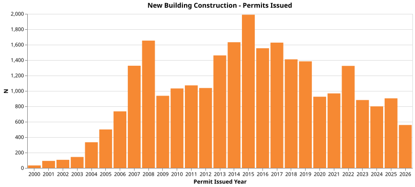
This visual represents the number of new building construction permits that have been allowed by the city. It shows how the permit allowance has varied over time and this is useful because all new housing built in the city requires permits.

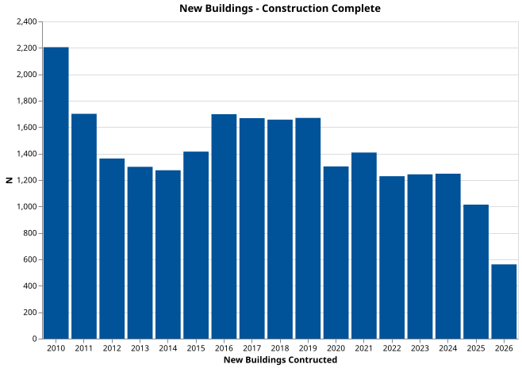
Similar to the previous visual this shows how many new building constructions have been completed in NYC over the past decade.

 
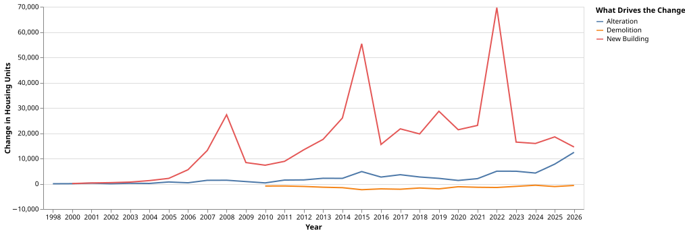
Line chart to show how the total number of housing units added over the past two decades have different sources. Alterations, and new building constructions. I also included demolitions because those result in a net loss in the total housing units available.

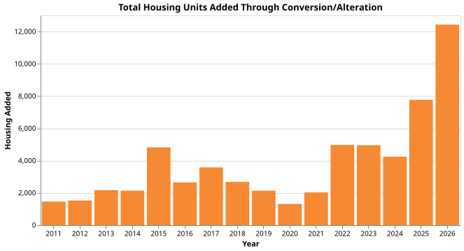
After making the previous visual I noticed a spike at the tail end of the alterations line - showing a sudden increase in the number of housing units added as a result of alterations, which I expand on using this and the following visual.

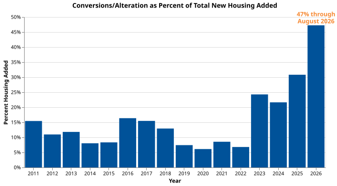
This shows that in 2026 almost 50% of the total new housing added has been a direct result of alterations - allowing me to tease out what is visible in NYC; the new administrations major puch on adding new housing to the market.

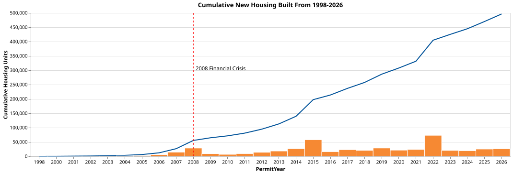
Providing a big picture view of the total cumulative new housing units added in NYC. I think it is interesting to look at how there were periods where there was practically no new housing being added and also notice a slump in housing post 2008 financial crisis.

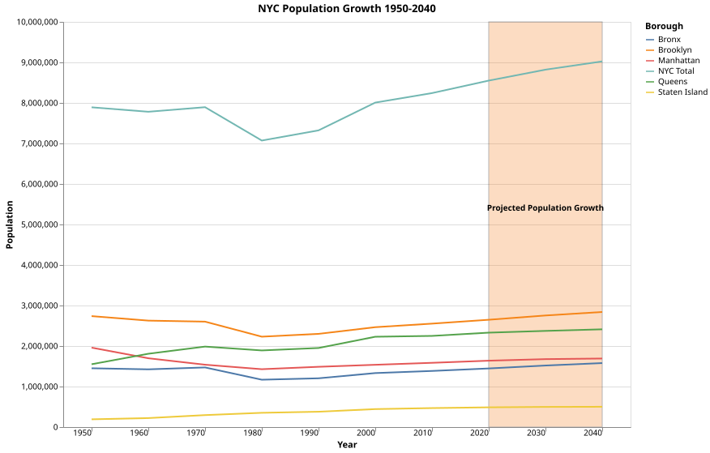
Pivoting to population to contextualize the mismatch between the population in NYC and housing available - this first visual just plots the total population in NYC and how it varies by boroughs alongside a line that shows the cumulative population across all boroughs.

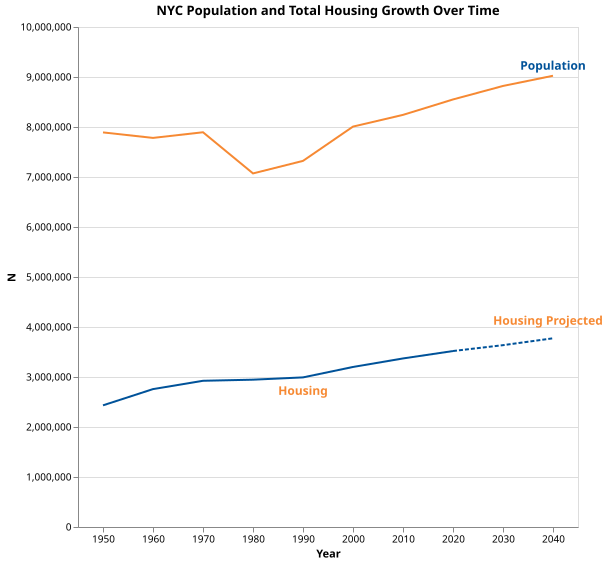
Bringing housing and population together to visualize the trend from 1950 onwards and how that might look like in the future. I use linear projection of housing units to visualize how housing would increase if it followed the same trend.

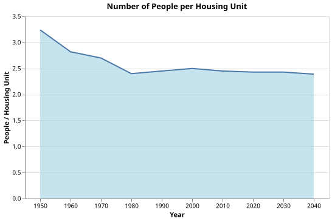
This area chart shows how the population by housing ratio has varied over the years and I use my projected number to extrapolate how that ratio might look like going forward.

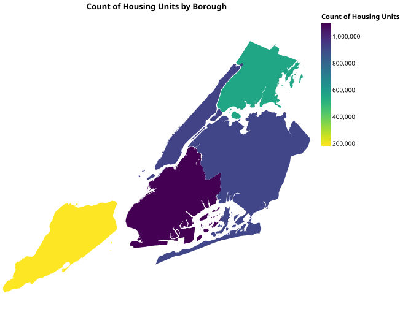
A choropleth to visualize how many total housing units are currently there in NYC across the 5 boroughs.

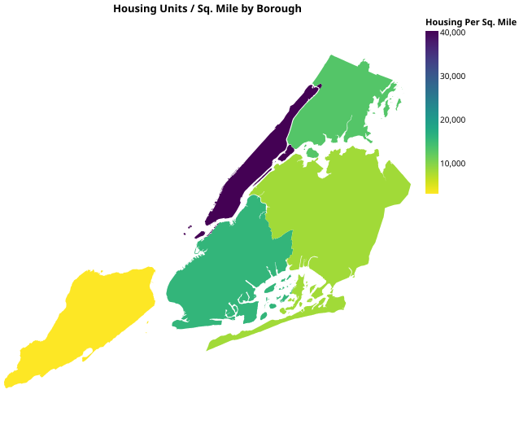
The visualzing above provides the count but the denominator can be misleading - I add this to show that even though Manhattan does not have the most units it still has the most housing units per square mile.

## Final Output:
I envision final deliverable to be an infographic implemented in HTML with CSS use to work on the layout and overall format of the display. 
